# Dr. Route — Intelligent Clinical Healthcare Navigation & Public Health Intelligence 🩺🚑

<p align="center">
  
</p>

<p align="center">
  <strong>Clinical-Grade Healthcare SuperApp & National Epidemiological Surveillance Platform</strong><br>
  Built with <strong>TypeScript</strong>, <strong>React</strong>, <strong>Tailwind CSS</strong>, and integrated with the <strong>Ayushman Bharat Digital Mission (ABDM M1–M3)</strong> standards.
</p>

<p align="center">
  <a href="#-system-architecture">Architecture</a> •
  <a href="#-12-screen-clinical-suite-walkthrough">12-Screen Suite</a> •
  <a href="#-tech-stack">Tech Stack</a> •
  <a href="#-getting-started">Getting Started</a> •
  <a href="#-security--regulatory-compliance">Compliance</a>
</p>

---

## 🌟 Executive Overview

**Dr. Route** is an enterprise-grade digital health navigation platform that bridges the gap between acute bedside clinical care, ambulatory e-prescriptions, and macro-level public health disease surveillance. Engineered with high-contrast clinical ergonomics and cryptographic trust, Dr. Route empowers physicians, hospital networks, and health authorities to deliver safe, coordinated, and data-driven patient outcomes.

---

## 🏛️ System Architecture

```mermaid
graph TD
    subgraph Client_Layer ["🖥️ Presentation Layer (React + TypeScript + Tailwind)"]
        UI_Login["1st: Secure Provider Login"]
        UI_Dash["2nd: Clinical Dashboard"]
        subgraph Rx_Module ["Prescription Suite"]
            UI_RxHub["3rd: Prescription Hub"]
            UI_Chart["4th: Submit & Open Chart"]
            UI_OldRec["5th: Inside Old Records"]
            UI_NewRx["6th: Inside New Prescription"]
            UI_Insights["7th: Inside Health Insights"]
        end
        subgraph Epi_Module ["Surveillance Suite"]
            UI_Epi["8th: Disease Epidemiology"]
            UI_Drug["9th: Drug Trends & AMR"]
        end
        subgraph Profile_Module ["Provider Practice"]
            UI_Prof["10th: Personal Profile"]
            UI_Qual["11th: Qualification & Experience"]
            UI_Set["12th: Practice Settings"]
        end
    end

    subgraph Core_Engine ["⚙️ Clinical Decision Support & Safety Engine"]
        AllergyEngine["Real-time Allergy Cross-Check"]
        DrugMatrix["Drug-Drug Interaction Matrix"]
        ICD10["ICD-10 Codification & Formulary"]
        RiskGauge["ASCVD 10-Yr Cardiovascular Risk AI"]
        SigEngine["SHA-256 Digital Signature Generator"]
    end

    subgraph Interop_Layer ["🌐 National Health Stack & Telemetry Grid"]
        ABHA["ABHA / ABDM Gateway (M1, M2, M3)"]
        FHIR["FHIR R4 Clinical Data Exchange"]
        HPR["Health Professional Registry (HPR)"]
        IDSP["IDSP / ICMR Outbreak Telemetry"]
        IoT["PulseBand v2 Continuous Vitals"]
    end

    UI_NewRx --> AllergyEngine
    UI_NewRx --> DrugMatrix
    UI_NewRx --> ICD10
    UI_NewRx --> SigEngine
    SigEngine --> UI_Chart
    UI_Chart --> RiskGauge
    UI_Chart --> IoT
    UI_OldRec --> FHIR
    UI_Login --> HPR
    UI_Set --> ABHA
    UI_Epi --> IDSP
    UI_Drug --> IDSP
```



---

## 📱 12-Screen Clinical Suite Walkthrough

### 1st — Secure Provider Login (`1st - login page`)
- **Multi-Factor Clinical Authentication**: Doctor ID / National Medical Commission (NMC) registration login, ABHA Health Professional Registry (HPR) ID authentication, and FIDO2 biometric passkey support.
- **1-Click Quick Demo Launcher**: Auto-fills verified credentials for **Dr. Aarav Mehta** (Chief Cardiologist & Epidemiologist) or Emergency Triage Officers for rapid evaluation.
- **Hospital Network SSO**: Integrated with Medanta The Medicity, Apollo Hospitals, Max Healthcare, and AIIMS.

### 2nd — Clinical Navigation Command Center (`2nd - Dashboard`)
- **Executive Triage Banner**: Active OPD session counter, ICU bed availability, and live regional outbreak alert ticker.
- **Key Performance Indicators**:
  - Today's Patient Schedule (24 Scheduled, 6 Waiting, 1 in Consultation).
  - Active Prescriptions under automated compliance tracking.
  - Level 2 Epidemiological Surge Warning (Dengue DENV-2).
  - Antimicrobial Resistance (AMR) sentinel watchlist.
- **Patient Queue**: Live prioritization (Emergency, Urgent, Routine) with direct 1-click action triggers (`Open Chart`, `Write Rx`, `View Records`, `AI Insights`).
- **Connected IoT Telemetry**: Streaming vitals from PulseBand v2 wearable devices (Blood Pressure, Heart Rate, SpO2, and Fasting Glucose).

### 3rd — Prescription Management Hub (`3rd - prescription`)
- **Centralized Clinical Formulary**: Comprehensive filter by regimen status (`Active`, `Needs Renewal`, `Flagged`).
- **Patient Regimen Cards**: Detailed medication breakdown, dosages, frequencies (e.g. `1-0-1`), duration, and adherence scores.
- **Instant Search**: Query by patient name, medication molecule, or ICD-10 diagnosis.

### 4th — Inside Prescription: Submit & Open Chart (`4th - Inside prescription submit and open chart`)
- **Physiological Response Curve**: Interactive visual tracking showing 6-month blood pressure reduction (162/98 mmHg → 136/84 mmHg) under Telmisartan + Metformin therapy.
- **Glycemic Progression**: Longitudinal HbA1c trajectory (7.9% → 6.8%) and fasting blood glucose response.
- **Adherence Meter**: 94.2% compliance rate logged via digital smart pill dispensaries and PulseBand telemetry.
- **Drug-Drug Interaction Safety Matrix**: Automated cross-verification showing zero contraindications between concurrent ARBs, Biguanides, and Statins.
- **Cryptographic Audit Seal**: Immutable SHA-256 digital signature stamp with doctor's NMC registration number and timestamp.

### 5th — Inside Old Records & Health Vault (`5th - Inside old records`)
- **Longitudinal EHR Vault**: ABDM M1–M3 compliant historical record archive categorized into:
  - 💊 Past Prescriptions (with stoppage reasons and dosage changes).
  - 🧪 Diagnostic Lab Panels (HbA1c, Lipid Profiles, Renal eGFR, Creatinine with normal vs. abnormal flags).
  - 🩻 Imaging & Cardiology (2D Echocardiograms, Left Ventricular Ejection Fraction 62%, Cardiac Doppler).
  - 🏥 Inpatient Discharge Summaries (Emergency admissions, ICU observations).
  - 💉 Immunizations (Influenza, PPSV23, COVID-19 boosters).
- **Interactive Document Inspector Modal**: Deep dive into test parameters, normal clinical ranges, and download encrypted ABDM packages.

### 6th — Inside New Prescription (`6th - Inside new prescription`)
- **Real-Time Allergy Collision Engine**: Active alert if the clinician attempts to prescribe a penicillin-class antibiotic (e.g., Augmentin) to a patient with a documented penicillin allergy.
- **ICD-10 Codification**: Primary and secondary diagnosis with instant ICD-10 chips (`I10.9 Hypertension`, `E11.9 Diabetes`, `J45 Asthma`).
- **Medication Adder**: Configurable dosages, administration frequencies, meal timings, durations, and refill limits.
- **Dietary & Lifestyle Prescriptions**: Structured DASH diet, exercise regimen, and fluid intake guidelines.
- **Primary CTA**: **"Submit & Open Chart"** signs the prescription with SHA-256 hash and immediately transitions to the interactive clinical chart.

### 7th — Inside Health Insights (`7th - Inside health insights`)
- **10-Year ASCVD Cardiovascular Risk**: Prognostic Framingham calculator visualizer showing risk reduction from 14.8% to 8.4%.
- **Metabolic 12-Month Forecast**: Machine-learning projection indicating target sub-6.5% HbA1c remission trajectory.
- **Biomarker Radar**: Multi-axis comparison of BP, LDL cholesterol, glucose, eGFR, and physical activity against international clinical targets.
- **AI Clinical Copilot**: Automated recommendations for statin de-escalation, diabetic nephropathy screening, and seasonal infection precautions.

### 8th — Disease Epidemiology (`8th - disease epidemiology`)
- **Sentinel Outbreak Surveillance**: Macro tracking of Dengue (DENV-2), Seasonal Influenza (H3N2/H1N1), Extensively Drug-Resistant (XDR) Typhoid, and Chikungunya.
- **Epidemiological Metrics**: Case counts, effective reproduction rate ($R_t$), positivity rates, and public ICU bed stress index.
- **Regional Hotspot Clusters**: Geographic surveillance covering Delhi NCR, Bengaluru, Kolkata, Pune, and Hyderabad.
- **Physician Directives**: ICMR guidelines for febrile triage, platelet preservation, and avoidance of NSAIDs.

### 9th — Drug Trends & Antimicrobial Stewardship (`9th - drug trends`)
- **Macro Prescription Volumes**: Monthly tracking of 1.28M prescriptions across partner networks.
- **Generic Substitution Metrics**: 74.6% generic penetration driven by Jan Aushadhi initiatives.
- **AMR Sentinel Watchlist**: Resistance percentages for Azithromycin (38.6%), Meropenem IV (46.8%), and Ciprofloxacin.
- **Supply-Chain Radar**: Real-time pharmacy inventory alerts to prevent stockouts of critical ICU antibiotics.

### 10th — Personal Profile (`10th - personal profile`)
- **Clinician Identity**: Dr. Aarav Mehta, MD (AIIMS), DM Cardiology (PGIMER), FACC.
- **Regulatory Accreditations**: National Medical Commission Registration `NMC-54921-A` and ABHA HPR ID `aarav.mehta@hpr.abdm`.
- **Practice Statistics**: 16+ years experience, 3,840+ PCI procedures, 99.2% success rate, 24 landmark publications.
- **Chambers & Contacts**: Medanta Heart Institute OPD hours, trauma emergency line, and downloadable digital visiting card.

### 11th — Qualification & Experience (`11th - qualification & experience`)
- **Academic Timeline**: MBBS (AIIMS Gold Medalist), MD Internal Medicine (AIIMS Best Resident), DM Cardiology (PGIMER First Order of Merit).
- **International Fellowships**: Fellow of the American College of Cardiology (FACC), European Society of Cardiology (FESC), and SCAI.
- **Career Journey**: Medanta The Medicity (Chief of Interventional Cardiology), Fortis Escorts Heart Institute, and AIIMS faculty tenure.
- **Landmark Publications**: Peer-reviewed studies in *The Lancet Regional Health*, *Circulation*, and *Indian Heart Journal*.

### 12th — Settings (`12th - settings`)
- **Security & 2FA**: Two-factor SMS/Authenticator authorization, biometric passkey login, and automatic session auto-lock timers.
- **ABDM Gateway Integration**: Bridge connection status (`https://gateway.abdm.gov.in/v0.5`), FHIR R4 schema compliance, and health ping tests.
- **Emergency Triage Preferences**: Code Blue push alert toggles, critical lab panic value notifications, and regional outbreak thresholds.
- **Clinical Defaults**: Generic-first naming, automated cryptographic e-signatures, and HIPAA/NMC audit log export (CSV).

---

## 💻 Tech Stack

| Category | Technology |
|---|---|
| **Frontend Framework** | React 18 with TypeScript 5 |
| **Bundler & Build Tool** | Vite 5 (Sub-second HMR & optimized production build) |
| **Styling & UI Tokens** | Tailwind CSS 3 (Clinical color palette, typography & shadows) |
| **Icons & Visual Language** | Lucide React (Clean clinical iconography) |
| **Typography** | Plus Jakarta Sans (Headings/Vitals) & Inter (Clinical body text) |
| **National Standards** | ABDM Milestone 1–3, FHIR R4, ABHA HPR |
| **Mobile Ecosystem** | Companion React Native / Expo application in `/mobile` |

---

## 🚀 Getting Started

### Prerequisites
- **Node.js**: v18.0.0 or higher (Tested with Node v25.2.1)
- **npm**: v9.0.0 or higher

### Installation & Local Run

```bash
# 1. Clone the repository
git clone https://github.com/Yashjain329/Dr.Route.git

# 2. Enter directory
cd Dr.Route

# 3. Install dependencies
npm install

# 4. Start Vite development server
npm run dev
```

Open your browser at `http://localhost:5173` to explore the full 12-screen suite.

### Production Build

```bash
# Build optimized production bundle
npm run build

# Preview production build locally
npm run preview
```

---

## 🔒 Security & Regulatory Compliance

- **ABDM Compliant**: Implements Ayushman Bharat Digital Mission (ABDM) guidelines for Health Professional Registry (HPR), Ayushman Bharat Health Account (ABHA), and Health Facility Registry (HFR).
- **FHIR R4 Schema**: Data structures align with Fast Healthcare Interoperability Resources (FHIR) standard.
- **Cryptographic Trust**: Pre-configured with SHA-256 digital signature hashes for e-prescriptions.
- **Privacy by Design**: Role-based access control, biometric authorization, and zero persistent storage of unencrypted PHI.

---

<p align="center">
  <strong>Dr. Route Healthcare Navigation System</strong><br>
  Designed & Developed for Clinical Excellence and Public Health Vigilance.
</p>
